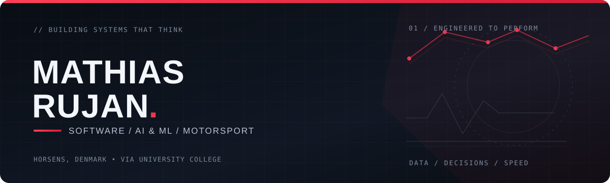

 

**Software engineering student · AI & ML enthusiast · Motorsport-driven builder**

I turn telemetry into insight, data into decisions, and ideas into working systems.

---

### `01 / ABOUT`

I'm a **Software Technology Engineering** student at **VIA University College**, specializing in **Artificial Intelligence & Machine Learning**. I enjoy building end-to-end systems where algorithms meet real-world constraints: low-latency data, predictive models, clean software architecture, and useful interfaces.

- 🏁 Building an **AI Race Engineer for F1 26** as my bachelor's project.
- ⚡ Part of **Formula Student Aarhus**, working on engineering challenges around a real race car.
- 🧠 Interested in **machine learning, real-time telemetry, intelligent decision systems, and software architecture**.
- 📍 Based in **Horsens, Denmark**.

### `02 / FEATURED WORK`

<table>
<tr>
<td width="50%" valign="top">

**🏎️ F1 26 — AI Race Engineer**

A real-time race engineering system that processes game telemetry and supports strategic decisions through data, modeling, and radio communication.

**Focus:** telemetry · predictive analytics · strategy · real-time systems

[Backend ↗](https://github.com/Tiaszz-03/BachelorProject_BE) · [Frontend ↗](https://github.com/Tiaszz-03/BachelorProject_FE)

</td>
<td width="50%" valign="top">

**🎙️ Race Engineer Radio**

Voice communication for an interactive race engineer, designed to deliver concise and context-aware race information.

**Focus:** Python · audio pipelines · integration · user experience

[Repository ↗](https://github.com/Tiaszz-03/ElevenLabs-Radio)

</td>
</tr>
</table>

**🏁 Formula Student Aarhus** — Engineering experience on a student motorsport team, connecting electronics, software, testing, and practical problem-solving.

### `03 / TOOLBOX`

**Languages & development**

**Data & infrastructure**

### `04 / GITHUB ACTIVITY`

Statistics reflect public GitHub data and may not include private work.

---

**ENGINEERING INTELLIGENCE. DRIVEN BY PERFORMANCE.**

Build. Measure. Improve. Repeat.

